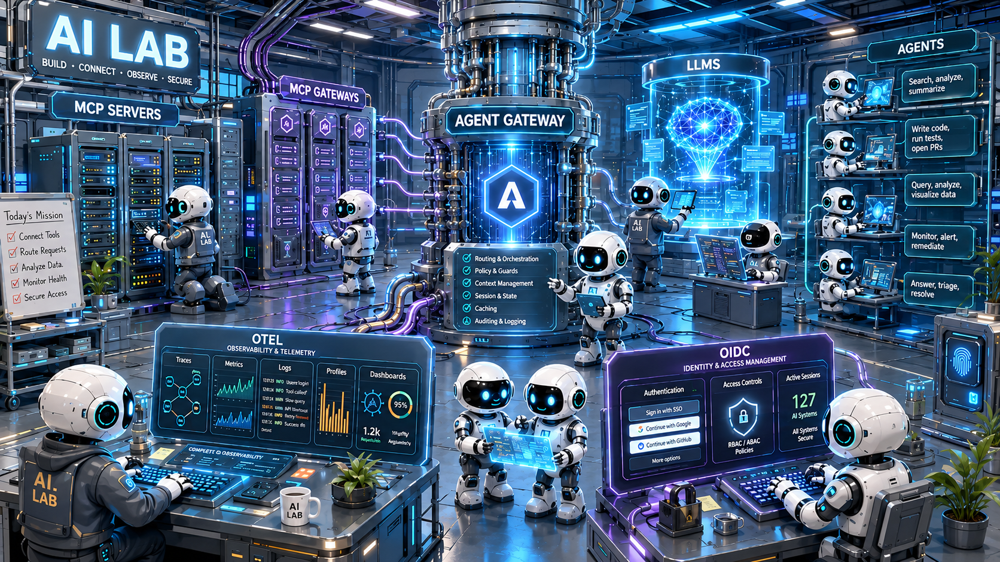

<p align="center">
  
</p>

# AI Lab: agents, A2A and MCP on a local Kind cluster

> A fully local, throwaway Kind cluster (Colima on macOS). The only external dependency is an LLM: a provider key,
> or a model served on your own Mac. The centrepiece is the **travel desk**: five Pydantic AI agents that talk to
> each other over A2A through agentgateway, with a durable workflow, human approval, and a web UI.

A local open-source AI platform lab running on a Kind cluster named `ai-lab-oss`.

**Agent-to-agent, in the open.** Separate agents coordinate over the open A2A protocol and reach their tools over open MCP, with every hop going through agentgateway. Agents are written with Pydantic AI (MIT, model-agnostic); nothing in the lab is proprietary.

**Durable, with a human in the loop.** A trip is a long-running workflow in Postgres. It holds a flight, waits (for minutes or days) for people to approve it under a price policy, books it, then watches the fare and proposes rebooking when it drops. Kill a pod mid-approval and the trip resumes where it was.

**Fully reproducible.** Kind on a laptop, Taskfile, and Helm for config, scriptable end to end.

---

## What this repository is for

A runnable reference for agentic AI on open-source infrastructure, small enough for a laptop and complete enough to demo and to build from. It exists to:

- **Show agent-to-agent (A2A) working end to end.** Five separate agents coordinate a trip over the open A2A protocol, use tools over MCP, and call models through an OpenAI-compatible gateway, with every hop routed by agentgateway.
- **Give Field Engineers and SAs a proven baseline** for customer conversations about AI gateways, so an engagement starts from a working setup instead of a blank page.
- **Support a side-by-side comparison with the Kong AI Lab.** It is built from the same kinds of parts (HTTP, LLM, MCP and A2A gateways, REST backends, analytics), so differences in routing, auth, observability and agent tooling can be shown rather than described (see [Capability comparison](#capability-comparison-with-kong-ai-lab)).
- **Stay vendor-neutral.** Pydantic AI (MIT), A2A and MCP are open standards; nothing here needs a proprietary component, and any OpenAI-compatible model works through LiteLLM.

It is a lab, not a product: routes are unauthenticated and the cluster is throwaway. Start with `DEMO.md` to present it and `TESTS.md` to verify it.

---

## Architecture

```
Client / browser
  │
  ├── traefik-api-gw.lab ──► Traefik OSS (Kubernetes Gateway API)
  │     └── /flights, /destinations, /book-flights ──► Go REST servers
  │
  ├── litellm.lab ──► LiteLLM Proxy
  │     └── /v1/chat/completions ──► OpenAI / Gemini / Ollama / local vLLM on the Mac
  │
  └── agentgateway.lab ──► agentgateway
        ├── /desk/                      ──► the web app and REST API (coordinator)
        ├── /a2a/trip-coordinator       ──► coordinator   (4300)  durable workflow + approvals, Postgres
        │     ├── /a2a/destination-scout ──► destination-scout (4301)  LLM: shortlist and rank
        │     ├── /a2a/flight-scout      ──► flight-scout      (4302)  LLM: quote dates, recommend
        │     ├── /a2a/booking-agent     ──► booking-agent     (4303)  no LLM: hold / confirm / cancel
        │     └── /a2a/fare-watcher      ──► fare-watcher      (4304)  durable: watches a fare for days
        ├── /mcp-travel-search          ──► Python FastMCP adapter → REST destinations + flights
        └── /mcp-bookings               ──► Python FastMCP adapter → REST book-flights
```

---

## What's in the lab

### Traefik: HTTP edge routing

Traefik OSS with Kubernetes Gateway API (`GatewayClass: traefik`). Routes all REST API traffic on `traefik-api-gw.lab`. Routes are plain `HTTPRoute` resources in `k8s/oss/routes/rest-apis.yaml`.

No auth enforcement; routes are open. Traefik does URL-prefix rewriting so `/flights` → `/` on the backend.

### LiteLLM: LLM gateway

OpenAI-compatible API proxy at `litellm.lab`. Aliases:

| Model alias | Backend | API key |
|---|---|---|
| `openai-gpt` | `gpt-4o-mini` | `OPENAI_API_KEY` |
| `gemini-pro` | `gemini-2.5-pro` | `GEMINI_API_KEY` |
| `ollama-llama` | `llama3.2` via Ollama | None (in-cluster) |
| `local-vllm` | the model served by vLLM-Metal on your Mac (see [Local inference](#local-inference)) | `VLLM_API_KEY` |
| `embedding-openai` | `text-embedding-3-small` | `OPENAI_API_KEY` |

Auth via master key (`sk-ai-lab-litellm`). Config lives in `k8s/oss/litellm/config.yaml`.

LiteLLM covers multi-provider routing, model aliasing, and an OpenAI-compatible API surface. It does not have, compared with Kong's LLM gateway: semantic routing, an AI semantic cache, prompt/response guardrails, per-consumer rate limiting, RAG injection, or token-budget enforcement.

### agentgateway: MCP and A2A

agentgateway (OCI Helm, `cr.agentgateway.dev/charts/agentgateway`) handles all agent and MCP traffic at `agentgateway.lab`.

**MCP backends**, declared as `AgentgatewayBackend` CRDs in `k8s/oss/routes/mcp-servers.yaml`:

| Route | Backend service |
|---|---|
| `/mcp-travel-search` | `mcp-travel-search:8000/mcp` |
| `/mcp-bookings` | `mcp-bookings:8000/mcp` |

**A2A and web routes**, plain `HTTPRoute` resources in `k8s/oss/routes/travel-desk.yaml`: `/a2a/trip-coordinator`, `/a2a/destination-scout`, `/a2a/flight-scout`, `/a2a/booking-agent`, `/a2a/fare-watcher`, and `/desk` for the web app. HTTPRoutes do not strip the path prefix, so each service serves under the same prefix.

All routes are unauthenticated. agentgateway does not enforce auth on MCP or A2A routes in this lab.

### The travel desk

Five Python services in `applications/agents/travel-desk/`, each its own uv project, sharing `common/` (model and MCP wiring, OTel, A2A client and server helpers, typed contracts).

| Agent | Port | What it is |
|---|---|---|
| `coordinator` | 4300 | The durable workflow, the approval model, the REST API, the web app, and an A2A endpoint. State in Postgres |
| `destination-scout` | 4301 | LLM agent. Shortlists destinations (MCP), drops the origin city, ranks by embedding similarity, explains why |
| `flight-scout` | 4302 | LLM agent. Quotes the route for every candidate date (MCP) and recommends one |
| `booking-agent` | 4303 | **No LLM.** Holds, confirms and cancels bookings (MCP). Moving money is plain code behind the same A2A interface |
| `fare-watcher` | 4304 | A durable agent. A workflow per booking wakes every 30s, re-quotes the fare, and tells the coordinator about meaningful drops |

**A trip, end to end.** A traveller writes a request in plain language. The coordinator extracts requirements (LLM), asks `destination-scout` and `flight-scout` over A2A, and *holds* the best flight through `booking-agent`. The approval policy then decides who must say yes:

| Flight price | Approvals needed |
|---|---|
| under 60 EUR | none, booked automatically |
| 60 to 180 EUR | one approver |
| 180 EUR and up | two different approvers |

An approver can **approve**, **reject**, or **edit** (pick another destination or date, which releases the hold and researches again). An approval nobody answers is **escalated** after 5 minutes and **expires** after 15, and an expired approval releases the hold. Once confirmed, `fare-watcher` watches the fare. When it drops by at least 8% and 10 EUR, a model judges whether rebooking is worth anyone's attention, and the coordinator asks for approval again. Approved rebooking is a saga: hold the new booking, confirm it, only then cancel the old one, so the traveller is never left without a seat. The policy, the TTLs and the monitoring window are environment variables (`k8s/oss/travel-desk/coordinator.yaml`).

**Design rules.**
- *Code owns the facts, models add judgment.* Prices, options and destinations come from tools; an output validator puts them back if a model changes them. Models read free text, rank, recommend and explain. They never decide who approves or what a booking costs.
- *The vocabulary is enforced in the contract.* Whatever a model extracts, only values the downstream services accept leave the `TripRequirements` model.
- *Every effect is a checkpointed step.* The coordinator and fare-watcher are [DBOS](https://docs.dbos.dev) workflows backed by Postgres (`desk-postgres`). A restart resumes in-flight trips, and waiting for a human is a durable `recv` that costs nothing.
- *Booking is a saga with idempotency.* A hold carries an idempotency key, confirm and cancel are harmless to repeat, and every failure path cancels the hold.
- *Approvals are rows, not pauses.* Who may approve, how many are needed, when it expires, every decision, all in Postgres. Concurrent decisions resolve exactly once.
- *The audit log is append-only.* A database trigger rejects any UPDATE or DELETE.

**Using it.**
- **Web app:** `http://agentgateway.lab/desk/`. Plan a trip, watch it research, work the approval queue, and (in demo mode) press "Simulate a fare drop". Type your name at the top right; that is who you approve as. A second approver must be a different name.
- **Terminal:** `applications/agents/travel-desk/desk_cli.py` does the same over the REST API, and `./desk_cli.py demo` runs a scripted end-to-end flow.
- **Over A2A:** other agents create trips and report fare events with typed messages (`create_trip`, `fare_event`, `get_trip`) to `/a2a/trip-coordinator`.

Each agent serves an agent card at `/a2a/<name>/.well-known/agent-card.json` and A2A JSON-RPC at `/a2a/<name>/`. `message/send` is asynchronous: it returns a task and the caller polls `tasks/get`.

### MCP servers

Two Python FastMCP adapters over the Go REST servers, on port 8000 at `/mcp` (StreamableHTTP).

| Server | Tools |
|---|---|
| `travel-search-adapter` | `list_destinations`, `shortlist_destinations`, `get_destination`, `list_airports`, `flight_price` |
| `bookings-adapter` | `hold_booking`, `confirm_booking`, `cancel_booking`, `get_booking`, `list_bookings` |

### REST APIs

Three Go REST servers, originally shared with the Kong AI Lab. This lab extends two of them, additively (defaults unchanged):

| Server | Route | Notes |
|---|---|---|
| `rest-flights` | `traefik-api-gw.lab/flights` | Flight search by route and date. With `FARE_TICK_SECONDS` set, fares move over time; with `ENABLE_FARE_SHOCKS=true`, `POST /v1/fare-shocks` pushes one route's fare up or down (the demo's fare drop) |
| `rest-destinations` | `traefik-api-gw.lab/destinations` | Destination listing with filtering. Accepts budgets `low`/`mid`/`high` and vibes `city beach nature culture food nightlife relax design` |
| `rest-book-flights` | `traefik-api-gw.lab/book-flights` | Bookings, SQLite-backed. `hold: true` reserves with an expiry, `idempotency_key` makes retries safe, and `POST /v1/bookings/{code}/confirm` and `/cancel` move a booking between `held`, `scheduled`, `cancelled` and `expired` |

OTEL env vars are configured on all three; the Go OTEL SDK is wired in the application code.

### Standalone examples

`agentic-examples/` holds small runnable examples of one idea each, for trying Pydantic AI and the agent protocols by hand and then
changing them. Every folder is self-contained (its own `pyproject.toml`, `uv.lock`, `.venv`, Taskfile, README and tests) and needs
no cluster: `tool_facts` (tools own the facts, a validator stops a model changing them), `mcp_tools` (an agent using MCP tools),
`human_approval` (pause before an irreversible tool), `a2a_pair` (two agents over A2A), `durable_approval` (a workflow that survives
a kill while it waits for a person) and `pydantic_model` (typed output and evals). Start with `agentic-examples/README.md`.

### Local inference

vLLM-Metal can serve a model on your Mac's GPU, exposed to the cluster as the `local-vllm` alias:

```bash
cd k8s
task inference:install     # once: vLLM-Metal via Homebrew (Apple Silicon)
task inference:run         # blocking terminal: serves VLLM_MODEL from .env
task inference:check       # model list plus a generation smoke test
task secrets:litellm && kubectl -n litellm rollout restart deploy/litellm   # load the URL and key into LiteLLM
task desk:model -- local-vllm    # point every desk agent at it (back: task desk:model -- openai-gpt)
```

Use **Qwen2.5-14B-Instruct 4-bit** with `VLLM_TOOL_PARSER=hermes` and `llm/qwen25-chat-template.jinja` (see `.env.example`). With Mistral-7B-Instruct-v0.3 and the `mistral` parser, vLLM returns tool calls as plain text and the model never stops, so tool-calling agents hang. The whole desk runs on Qwen2.5-14B, in roughly 85 seconds to reach the first approval against about 35 with OpenAI.

### LLM Analytics

Identical to the Kong AI Lab. Kafka consumer → embedding → DBSCAN clustering → plugin recommendations → React UI.

```
Kong LLM GW (kafka-log) or LiteLLM → Kafka topic: llm-usage
  → Ingestor (Python)
      generates sentence-transformer embeddings
      stores prompt + embedding + metadata in Postgres/pgvector
    → Analyzer (Python, CronJob every 5 min)
        DBSCAN clustering → Kong plugin recommendations
      → FastAPI (/stats, /requests, /clusters, /recommendations)
        → React UI at analytics.lab
```

The analytics pipeline uses the `kafka-log` plugin output format — when used with LiteLLM, a custom log middleware would be needed to produce the same format.

### Supporting services

| Service | Namespace | Purpose |
|---|---|---|
| Keycloak | `keycloak` | OIDC identity provider (present, not enforced on routes) |
| Kafka (KRaft) | `kafka` | Message broker; exposed directly on `kafka-direct.lab:9092` |
| Postgres + pgvector | `llm-analytics` | Stores LLM logs, embeddings, clusters, recommendations |
| Ollama | Host machine | Local LLM inference via `host.docker.internal` |
| Grafana LGTM | `otel-lgtm` | OTel collector, Loki, Tempo, Prometheus, Grafana — one container |
| Kafka UI | `kafka-ui` | Kafka management UI at `kafka-ui.lab` |

---

## How it's put together

All cluster operations are driven by `task` from the `k8s/` directory.

| Task | What it does |
|---|---|
| `task up` | Full setup: cluster → namespaces → build → secrets → helm → manifests → oss overlays → route → hosts |
| `task down` | Deletes the Kind cluster (`ai-lab-oss`) |
| `task build` | Builds and loads all custom Docker images into Kind |
| `task secrets` | Creates the `keycloak-realm` and `litellm-env` k8s Secrets |
| `task helm:install` | Installs MetalLB, Traefik, Keycloak, agentgateway |
| `task manifests:apply` | Applies base manifests (Kafka, otel-lgtm, Postgres, REST servers, MCP servers, Ollama, etc.) |
| `task oss:manifests-apply` | Applies Traefik routes, LiteLLM, agentgateway backends and the travel desk |
| `task build:desk` / `task oss:desk-apply` | Rebuild the 5 desk agents / redeploy and restart them |
| `task desk:model -- <alias>` | Point every desk agent at another LiteLLM alias |
| `task eval` | Run the desk evals against the live lab (`-- --suite extraction` for the model-only suite) |
| `task inference:install/run/check` | Local vLLM on the Mac (see [Local inference](#local-inference)) |
| `task doctor` | Preflight: tools, Colima network address, `.env` keys |
| `task hosts:apply` | Writes `.lab` hostnames to Mac `/etc/hosts` |
| `task dns:apply` | Patches CoreDNS rewrites for in-cluster `.lab` resolution |
| `task colima:route` | Adds macOS route so MetalLB IPs are reachable |

**Helm releases:**
1. **MetalLB**: assigns real IPs from the Kind Docker subnet
2. **Traefik**: `traefik/traefik`, GatewayClass `traefik`, LoadBalancer at `172.18.255.210`
3. **Keycloak**: CloudPirates OCI chart, realm imported on startup
4. **agentgateway**: `cr.agentgateway.dev/charts/agentgateway` v1.2.0, GatewayClass `agentgateway`

**Tests.** Each agent project has unit tests: `cd applications/agents/travel-desk/<project> && uv run pytest`. The coordinator's and fare-watcher's tests start a throwaway Postgres in Docker (they skip without Docker). **Evals** run against the live lab: `cd k8s && task eval`. The extraction suite scores how well a model reads trip requests (compare models with `-- --suite extraction --model local-vllm`); the desk suite creates real trips, applies a human decision, and checks that the policy was respected, the outcome matches the decision, no hold was left behind, and the audit trail is complete.

---

## Repository structure

```
.
├── applications/
│   ├── agents/travel-desk/               # the travel desk, one uv project each
│   │   ├── common/                       # model/MCP/OTel wiring, A2A helpers, typed contracts
│   │   ├── coordinator/                  # durable workflow, approvals, REST API, web app (port 4300)
│   │   ├── destination-scout/            # (4301)
│   │   ├── flight-scout/                 # (4302)
│   │   ├── booking-agent/                # (4303)
│   │   ├── fare-watcher/                 # (4304)
│   │   ├── evals/                        # pydantic-evals: extraction and live end-to-end
│   │   └── desk_cli.py                   # drive the desk from a terminal
│   ├── keycloak/                         # Realm export
│   ├── llm-analytics/                    # Kafka → Postgres analytics pipeline
│   │   ├── ingestor/                     # Kafka consumer + embeddings
│   │   ├── analyzer/                     # DBSCAN clustering + recommendations
│   │   ├── api/                          # FastAPI: /stats /requests /clusters
│   │   └── ui/                           # React dashboard (Vite + nginx)
│   ├── mcp-servers/
│   │   ├── travel-search-adapter/        # destinations + flight fares
│   │   └── bookings-adapter/             # hold / confirm / cancel
│   └── rest-servers/                     # Go REST APIs (flights, destinations, book-flights)
│
├── agentic-examples/                     # standalone examples, one self-contained uv project each (no cluster)
├── inference/                            # vLLM-Metal scripts (run, check, host discovery)
├── llm/                                  # chat templates for local models
│
├── k8s/
│   ├── Taskfile.yaml                     # All cluster operations
│   ├── helm/                             # Helm values (traefik, keycloak, agentgateway, metallb)
│   ├── manifests/                        # Base services (kafka, otel-lgtm, postgres, REST servers, MCP servers)
│   └── oss/
│       ├── agentgateway/                 # Gateway CRD (agentgateway-proxy)
│       ├── kafka/                        # Direct external Kafka listener
│       ├── litellm/                      # LiteLLM Deployment, ConfigMap, Service
│       ├── routes/                       # HTTPRoutes (rest-apis, travel-desk, mcp-servers, litellm)
│       ├── travel-desk/                  # Desk Deployments, Services, and its Postgres
│       └── traefik/                      # Traefik Gateway CRD
│
└── docs/                                 # Architecture diagrams and the enablement deck (PDF)
```

---

## Setup

### Prerequisites

| Tool | Notes |
|---|---|
| [Colima](https://github.com/abiosoft/colima) | macOS Docker runtime — `--network-address` required |
| [Kind](https://kind.sigs.k8s.io/) | Kubernetes in Docker |
| [kubectl](https://kubernetes.io/docs/tasks/tools/) | |
| [Helm](https://helm.sh/) | |
| [Task](https://taskfile.dev/) | |
| [uv](https://docs.astral.sh/uv/) | Only to run the tests, evals and examples locally |
| OpenAI API key | Needed for the agents (`openai-gpt`, `embedding-openai`). The cluster comes up without it |
| [vLLM-Metal](https://github.com/vllm-project/vllm-metal) | Optional: a local model on Apple Silicon via `task inference:install` |
| Google Gemini API key | Optional |
| [Ollama](https://ollama.com/) | Optional, only for the `ollama-llama` alias |

### Step 1 — Start Colima

```bash
colima start --cpu 6 --memory 12 --disk 100 --network-address --vm-type vz --mount-type virtiofs
```

### Step 2: Add your key

```bash
cp .env.example .env     # then set OPENAI_KEY (and optionally GEMINI_KEY, or the VLLM_* block for a local model)
cd k8s && task doctor    # preflight check
```

### Step 3: Bring up the cluster

```bash
cd k8s
task up
```

Runs in order: Kind cluster → namespaces → build images → secrets → Helm releases → base manifests → OSS overlays → MetalLB routes → hosts.

The `colima:route` step asks for your Mac password. When it finishes, open `http://agentgateway.lab/desk/`.

---

## Hostnames

| Hostname | Service |
|---|---|
| `traefik-api-gw.lab` | Traefik — REST API routes (port 80) |
| `litellm.lab` | LiteLLM Proxy (port 80, forwards to 4000) |
| `agentgateway.lab` | agentgateway: MCP and A2A routes, and the travel desk web app at `/desk/` (port 80) |
| `kafka-direct.lab:9092` | Direct Kafka listener |
| `keycloak.lab:8080` | Keycloak |
| `analytics.lab` | LLM Analytics React dashboard |
| `analytics-api.lab` | LLM Analytics FastAPI |
| `grafana.lab:3000` | Grafana (otel-lgtm bundle) |
| `kafka-ui.lab` | Kafka UI |

`task hosts:apply` writes these to Mac `/etc/hosts`. `task dns:apply` patches CoreDNS so they resolve inside the cluster too. IPs are pinned via MetalLB annotations and don't drift across `task down` / `task up`.

---

## Demos

Full scripts live in `DEMO.md`. Quick-start snippets below.

### LLM routing {#llm-routing-demo}

```bash
# List available models
curl -H "Authorization: Bearer sk-ai-lab-litellm" http://litellm.lab/v1/models | jq .

# Call OpenAI via LiteLLM
curl http://litellm.lab/v1/chat/completions \
  -H "Authorization: Bearer sk-ai-lab-litellm" \
  -H "Content-Type: application/json" \
  -d '{"model":"openai-gpt","messages":[{"role":"user","content":"What is LiteLLM?"}]}' | jq .

# Call Gemini via LiteLLM
curl http://litellm.lab/v1/chat/completions \
  -H "Authorization: Bearer sk-ai-lab-litellm" \
  -H "Content-Type: application/json" \
  -d '{"model":"gemini-pro","messages":[{"role":"user","content":"What is LiteLLM?"}]}' | jq .

# Call local Ollama via LiteLLM
curl http://litellm.lab/v1/chat/completions \
  -H "Authorization: Bearer sk-ai-lab-litellm" \
  -H "Content-Type: application/json" \
  -d '{"model":"ollama-llama","messages":[{"role":"user","content":"What is LiteLLM?"}]}' | jq .
```

### MCP tools {#mcp-demo}

```bash
# MCP is stateful: initialize first, then send the Mcp-Session-Id it returns on every later call.
for ENDPOINT in mcp-travel-search mcp-bookings; do
  SID=$(curl -s -D - -o /dev/null -X POST http://agentgateway.lab/$ENDPOINT \
    -H "Content-Type: application/json" -H "Accept: application/json, text/event-stream" \
    -d '{"jsonrpc":"2.0","id":1,"method":"initialize","params":{"protocolVersion":"2025-03-26","capabilities":{},"clientInfo":{"name":"demo","version":"1"}}}' \
    | grep -i '^mcp-session-id' | awk '{print $2}' | tr -d '\r')
  echo "$ENDPOINT:"
  curl -s -X POST http://agentgateway.lab/$ENDPOINT \
    -H "Content-Type: application/json" -H "Accept: application/json, text/event-stream" -H "Mcp-Session-Id: $SID" \
    -d '{"jsonrpc":"2.0","id":2,"method":"tools/list"}' \
    | sed -n 's/^data: *//p' | jq -r '.result.tools[].name'
done
```

All MCP endpoints are open (no auth required).

### The travel desk {#a2a-demo}

```bash
open http://agentgateway.lab/desk/           # the web app: plan a trip, approve, watch it get booked

cd applications/agents/travel-desk
./desk_cli.py demo                           # scripted: plan, approve, fare drop, rebook, audit trail

# or by hand
./desk_cli.py new "A culture weekend from Amsterdam around 18 December, mid budget, museums please." --as alice
./desk_cli.py inbox                          # what is waiting for a human
./desk_cli.py approve <approval_id> --as bob --comment "looks good"
./desk_cli.py drop <trip_id>                 # demo: push the booked fare down; the watcher notices within 30s
./desk_cli.py show <trip_id>                 # proposal, approvals and the full audit trail

# the same coordinator over raw A2A: message/send returns a task, poll tasks/get
curl -X POST http://agentgateway.lab/a2a/trip-coordinator/ -H "Content-Type: application/json" \
  -d '{"jsonrpc":"2.0","id":1,"method":"message/send","params":{"message":{"kind":"message","messageId":"m1","role":"user","parts":[{"kind":"data","data":{"type":"create_trip","request":"A culture weekend from Amsterdam in mid December","requested_by":"agent"}}]}}}' | jq .
```

To see the durability, create a trip, wait until it is awaiting approval, then `kubectl -n travel-desk delete pod -l app=coordinator`. When the new pod is up the approval is still there, and approving it completes the booking.

### LLM Analytics {#llm-analytics-demo}

```bash
# Trigger the analyzer manually
kubectl create job --from=cronjob/llm-analyzer trigger-$(date +%s) -n llm-analytics

# Open the dashboard
open http://analytics.lab
```

---

## Observability

All components push to Grafana LGTM (`grafana.lab:3000`, default credentials `admin/admin`) via OTLP on port 4318. No Prometheus scraping, no log agent.

| Component | Traces | Logs | Metrics |
|---|---|---|---|
| `rest-flights` | ✓ | ✓ OTLP + stdout | ✓ |
| `rest-destinations` | ✓ | ✓ OTLP + stdout | ✓ |
| `rest-book-flights` | ✓ | ✓ OTLP + stdout | ✓ |
| Travel desk agents (×5) and the MCP adapters | ✓ | ✓ OTLP + stdout | ✓ |
| LiteLLM | ✗ (Prometheus metrics on `/metrics`) | stdout | ✗ |
| agentgateway | ✗ | stdout | ✗ |

The agents are instrumented with Starlette, httpx and Pydantic AI (`Agent.instrument_all()`), and trace context travels across every A2A hop through agentgateway. A trip's research shows up in Tempo as one tree: coordinator → scout → MCP tool → REST API, with the LLM calls inside each agent. The approval is a separate trace (it starts when a human decides), and the DBOS workflow steps are in the audit log rather than in the trace.

---

## Capability comparison with Kong AI Lab

| Feature | This lab (OSS) | Kong AI Lab | Notes |
|---|---|---|---|
| HTTP routing | Traefik OSS | Kong API GW | Both cover the basics; Kong has a plugin ecosystem |
| LLM gateway | LiteLLM (5 aliases incl. a local model, key auth) | Kong LLM GW | LiteLLM: multi-provider, aliases. Kong adds: semantic routing, semantic cache, guardrails, RAG, token budgets, per-consumer rate limits |
| MCP | agentgateway (open, no auth) | Kong MCP GW | agentgateway routes MCP natively; Kong adds OAuth2 scope ACL, key-auth ACL, token exchange |
| Agent framework | Pydantic AI (Python, MIT) | TypeScript agents | Different runtimes. Pydantic AI is model-agnostic and runs against LiteLLM here |
| A2A agents | FastA2A servers, routed by agentgateway | A2A routed through Kong | Both speak the open A2A protocol |
| Long-running agents | DBOS workflows on Postgres | n/a | Durable approvals, fare watching, restart-safe |
| Auth enforcement | Keycloak present, routes unauthenticated | Keycloak + OIDC on every route | Significant gap: Kong enforces auth at the gateway layer |
| Observability | REST servers, MCP adapters and the agents all OTEL-wired (traces+logs+metrics); LiteLLM/agentgateway logs-only | All components fully wired (OTEL traces + logs + metrics) | LiteLLM/agentgateway still a gap |
| LLM Analytics | Full pipeline (Kafka → Postgres → React) | Same | Parity |
| MCP adapters | Python FastMCP (explicit adapter per API) | Kong ai-mcp-proxy (auto-converts REST) | Kong approach is zero-code |
| Event/Kafka | Direct Kafka exposure | Kong Event Gateway (protocol proxy + auth) | Kong adds a managed broker layer |
| Insomnia files | None | 7 Insomnia v5 files | Gap |

---

## Known gaps

- **Approver identity is a typed name.** The web app and REST API trust the name you give; there is no login. Keycloak is deployed but not wired in, so "who approved" is an honour system and a second approver only has to be a different string.
- agentgateway routes are open: no auth, no scope enforcement on MCP or A2A endpoints.
- An agent keeps its MCP session open, so if an MCP server pod is replaced, restart the agents that use it (`kubectl rollout restart deploy -n travel-desk`) or their tool calls return 404.
- The coordinator and fare-watcher each run a single replica (Recreate strategy): one workflow engine per database.
- Fares are simulated. With `FARE_TICK_SECONDS` they random-walk deterministically; a real fare feed would replace `rest-flights`.
- LiteLLM has no OTEL export: it exposes a `/metrics` Prometheus endpoint but doesn't push to LGTM.
- No Insomnia collection files for MCP demo flows.
- LLM Analytics pipeline was designed around the `kafka-log` plugin output format; using it with LiteLLM requires a compatible log middleware.
